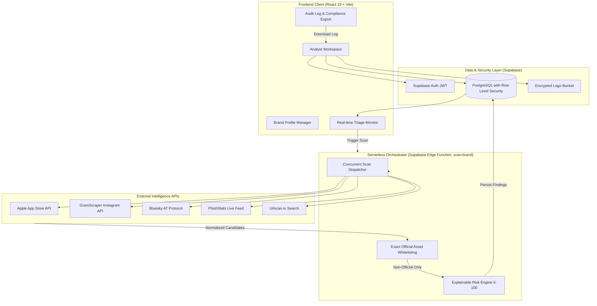

<div align="center">

# 🛡️ Byte Guard

**Autonomous Digital Risk Protection Platform for Social & App Store Impersonation**

[](https://react.dev/)
[](https://www.typescriptlang.org/)
[](https://vitejs.dev/)
[](https://tailwindcss.com/)
[](https://supabase.com/)
[]()

*Defend your brand reputation against rogue mobile apps, fake social profiles, handle squatting, and phishing campaigns using explainable, multi-signal threat intelligence.*

</div>

---

## 📖 Table of Contents

- [Overview](#overview)
- [Key Features](#key-features)
- [Tech Stack](#tech-stack)
- [Integrated APIs & Intelligence Providers](#integrated-apis--intelligence-providers)
- [System Architecture](#system-architecture)
- [Detection & Risk Scoring Methodology](#detection--risk-scoring-methodology)
- [Hackathon Presentation Blueprint](#hackathon-presentation-blueprint)
- [Local Development & Setup](#local-development--setup)
- [Project Structure](#project-structure)
- [Security & Compliance Guardrails](#security--compliance-guardrails)

---

## Overview

Threat actors increasingly target customer trust outside traditional corporate network boundaries—registering fake brand profiles on social media, launching look-alike mobile apps under rogue developer names, and deploying phishing landing pages.

**Byte Guard** is a specialized Digital Risk Protection (DRP) platform built for **Social Media & Mobile App Store Surveillance**. By establishing an authoritative baseline of an organization's verified digital assets, Byte Guard continuously uncovers typo-squatted variations, publisher discrepancies, and unauthorized accounts across external ecosystems.

> [!NOTE]
> **Defensive & Passive by Design:** Byte Guard operates strictly against public registries, official search APIs, and structured threat telemetry. It never performs invasive network scanning, crawling, or automated takedowns without human verification.

---

## Key Features

### 1. Authoritative Brand Ground Truth
- Define legitimate brand identifiers: official corporate names, trademark aliases, verified primary domains, and official logos.
- Register verified iOS App Store IDs, Android package names (`com.company.app`), and official social media handles.
- **Zero-False-Positive Whitelist Precedence**: Verified corporate assets are mathematically excluded from the threat queue so legitimate releases are never falsely flagged.

### 2. App Store Surveillance
- Discovers suspicious applications across mobile app marketplaces (Apple App Store API).
- Detects **Publisher Discrepancies** (e.g. third-party rogue developer publishing an app titled with protected brand terms).
- Inspects bundle identifiers, app store titles, screenshots, descriptions, and user ratings.

### 3. Social Media Monitoring
- Live surveillance across traditional and decentralized networks:
  - **Instagram API (via GramScraper)**: Identifies fake customer support handles, impersonation profiles, copycat logos, follower counts, and bio link redirects.
  - **Bluesky (AT Protocol)**: Monitors next-generation decentralized handles for brand squatting and deceptive personas.

### 4. Live Threat & Phishing Intelligence
- **PhishStats Feed**: Real-time correlation against active verified phishing observations, capturing malicious hostnames, IP geography, and antivirus engine detections.
- **Urlscan.io Observatory**: Passive domain and URL intelligence for detecting parked look-alikes and fraudulent web portals.

### 5. Algorithmic Look-Alike & Typosquatting Detection
- Identifies common brand attack patterns:
  - **Character Swaps & Homoglyphs**: e.g., `0` for `o`, `1` for `l`, `rn` for `m`.
  - **High-Risk Keywords & Affixes**: Automatically appends and tests variants with `support`, `app`, `login`, `official`, `verify`, and `claims`.
  - **Punctuation & Spacing Shifts**: Hyphens, underscores, and spacing permutations.

### 6. Explainable Risk Scoring (0–100)
- Replaces uninterpretable AI "black boxes" with an explainable multi-signal breakdown:
  - **Name Match Weight**: Levenshtein lexical distance and token overlap.
  - **Publisher Variance Penalty**: Heavy penalty (+70) when an app bears the brand name but originates from an unverified developer.
  - **Bio & Link Divergence**: Penalizes external URLs pointing to unverified domains.
  - **Threat Intelligence Match**: Elevated score upon correlation with verified phishing registries.

---

## Tech Stack

### Frontend Architecture
- **Framework**: [React 19](https://react.dev/) + [TypeScript 5.7](https://www.typescriptlang.org/)
- **Bundler & Tooling**: [Vite 6](https://vitejs.dev/) with Hot Module Replacement
- **State Management & Caching**: [@tanstack/react-query v5](https://tanstack.com/query)
- **Styling**: [Tailwind CSS v3.4](https://tailwindcss.com/) with a modern, high-density monochrome enterprise design system
- **Components & Forms**: [React Hook Form](https://react-hook-form.com/) + [Zod v3](https://zod.dev/) validation
- **Icons**: [Lucide React](https://lucide.dev/)

### Backend & Orchestration
- **Serverless Runtime**: [Deno](https://deno.com/) via **Supabase Edge Functions**
- **Concurrency**: Parallel scan dispatcher using `Promise.allSettled` with per-provider circuit-breaking and 8-second timeouts
- **Authentication**: Supabase Auth with Bearer JWT tokens and Row Level Security (RLS)

### Database & Storage
- **Database**: [PostgreSQL](https://www.postgresql.org/) managed via Supabase
- **Storage**: Supabase Storage with strict MIME-type (PNG/JPEG/WebP) and 5MB payload limits for brand logos
- **Audit Logging**: Immutable, timestamped history of all analyst triage reviews, feedback notations, and scan snapshots

### Testing & Quality Assurance
- **Unit & Integration Suite**: [Vitest](https://vitest.dev/) + [Testing Library](https://testing-library.com/) (`@testing-library/react`, `@testing-library/jest-dom`)
- **Environment**: `jsdom`
- **Linting**: ESLint 9 + TypeScript-ESLint

---

## Integrated APIs & Intelligence Providers

| Provider / API | Target Category | Integration Endpoint | Data Extracted & Analyzed | Auth / Key Location |
| :--- | :--- | :--- | :--- | :--- |
| **Apple iTunes Search API** | Mobile Apps | `itunes.apple.com/search?entity=software` | App titles, seller/developer name, bundle ID, store URL, icon URL, ratings, download heuristics | Public (No key required) |
| **GramScraper (Instagram API)** | Social Media | RapidAPI GramScraper (`fbsearch/reels`, `user/by/username`) | Profile names, usernames, follower metrics, bio description, external website links, verification flags | Supabase Function Secret (`GRAMSCRAPER_API_KEY`) |
| **Bluesky Public API** | Social Media | AT Protocol (`public.api.bsky.app/xrpc`) | Display names, `.bsky.social` handles, actor bio text, avatars | Public (No key required) |
| **PhishStats Feed** | Threat Intel | `api.phishstats.info/api/phishing` | Active phishing records, malicious URL targets, IP addresses, country codes, antivirus consensus | Public (No key required) |
| **Urlscan.io Search API** | Threat Intel | `urlscan.io/api/v1/search` | Historical URL scans, page titles, observed domain metadata, screenshot snapshots | Supabase Function Secret (`URLSCAN_API_KEY`) |

> [!TIP]
> **Zero Client-Side Secret Exposure:** All secret keys (`URLSCAN_API_KEY`, `GRAMSCRAPER_API_KEY`) reside exclusively in encrypted Supabase Edge Function environment variables. The client application only possesses a public, RLS-scoped anon key.

---

## System Architecture



---

## Detection & Risk Scoring Methodology

Byte Guard computes an explainable heuristic score between **0 and 100** for each discovered candidate:

$$\text{Final Risk Score} = \min\left(100, \sum w_i \cdot S_i\right)$$

### Evaluated Threat Signals:
1. **Name Similarity Signal ($S_{\text{name}}$)**: Lexical similarity computed between the candidate name/title and protected brand aliases.
2. **Publisher Discrepancy Signal ($S_{\text{pub}}$)**:
   * **0 pts**: Publisher matches verified official organization name.
   * **+70 pts**: Publisher differs from verified brand owner (strong indicator of copycat app or fake profile).
3. **Link / Domain Signal ($S_{\text{link}}$)**:
   * **0 pts**: Bio or app landing link resolves to a verified brand domain.
   * **+70 pts**: External link points to an unknown or unverified third-party host.
4. **Threat Intelligence Signal ($S_{\text{threat}}$)**:
   * Ingests the normalized confidence score from live phishing feeds (PhishStats / Urlscan.io).

### Severity Classification:
- 🔴 **Critical (80–100)**: Known phishing observation, or direct name duplicate with publisher discrepancy and external suspicious redirect.
- 🟠 **High (60–79)**: Close name match with third-party publisher or unverified contact handle.
- 🟡 **Medium (40–59)**: Keyword overlap without explicit malicious indicators.
- 🟢 **Low / Informational (<40)**: Distant lexical match or community mention.

---

## Hackathon Presentation Blueprint

*Designed for the Kampus.VC Applied AI Hackathon — 100-Point Evaluation Criteria:*

### 1. Rubric Mapping

| Criterion | Weight | How Byte Guard Satisfies It |
| :--- | :---: | :--- |
| **Social Media Monitoring** | **30%** | Instagram & Bluesky integrations surface fake support accounts, scam profiles, and impersonators; official brand accounts are automatically whitelisted. |
| **App Store Monitoring** | **30%** | Apple App Store search flags rogue developers, bundle ID typos, and cloned descriptions; official app bundle IDs and seller IDs are exempted. |
| **Brand Profile Ground Truth** | **15%** | Structured management of official brand names, trademarks, verified domains, developer IDs, and social handles that guide detection. |
| **User Experience & Reliability** | **15%** | High-density monochrome interface, instant filtering, one-click triage notes, and graceful fallback when external sources are offline. |
| **Presentation & Live Demo** | **10%** | Polished working prototype with live scan execution, drawer inspection, and instant audit log export. |
| **Bonus: Look-alike Detection** | **+5–10 pts** | Typosquatting engine handling character swaps (homoglyphs), spacing/hyphen variations, and prefix/suffix attacks (`support`, `app`, `login`). |

### 2. 7-Slide Pitch Deck Structure

1. **Slide 1: Hook & Problem**: Brand impersonation has shifted to external app stores and social support scams where perimeter defenses fail.
2. **Slide 2: Brand Ground Truth**: Establishing official asset baselines to eliminate false positives.
3. **Slide 3: Surveillance Engine**: Multi-vector monitoring across Apple App Store, Instagram, Bluesky, and PhishStats.
4. **Slide 4: Look-Alike & Scoring**: Homoglyphs, publisher discrepancy penalties, and explainable 0–100 risk scoring.
5. **Slide 5: Architecture**: Passive intelligence pipeline, Supabase Edge concurrency, and secure secret vaults.
6. **Slide 6: Live Product Demo**: One-click scan, triage drawer, and zero-false-positive verification.
7. **Slide 7: Venture Vision & Roadmap**: Evolution into automated takedown packet generation (DMCA/abuse API) and enterprise SIEM webhooks.

---

## Local Development & Setup

### Prerequisites
- [Node.js](https://nodejs.org/) (v20+ recommended)
- `npm` or `pnpm`
- (Optional) [Supabase CLI](https://supabase.com/docs/guides/cli) for local Edge Function testing

### Installation

```bash
# 1. Clone repository
git clone https://github.com/yashodhar-exe/byte-guard.git
cd byte-guard

# 2. Install dependencies
npm install

# 3. Configure environment variables (optional for local synthetic demo)
cp .env.example .env

# 4. Start local development server
npm run dev
```

> [!TIP]
> **Synthetic Demo Mode:** If `VITE_SUPABASE_PUBLISHABLE_KEY` is not configured, Byte Guard automatically launches in an interactive **Synthetic Demo Mode** equipped with pre-loaded mock brands and live-simulated triage findings.

### Available Commands

| Command | Description |
| :--- | :--- |
| `npm run dev` | Starts Vite local development server at `http://localhost:5173` |
| `npm run build` | Compiles TypeScript and builds optimized production bundle |
| `npm run test` | Executes unit and integration tests using Vitest |
| `npm run lint` | Runs ESLint 9 code quality checks with zero-warning threshold |
| `npm run seed:demo` | Seeds sample brand and candidate fixtures into connected Supabase instance |

---

## Project Structure

```text
byte-guard/
├── docs/                               # Architectural and integration specifications
│   ├── architecture.md                 # System flow and data boundaries
│   ├── api-integrations.md             # Provider contracts, limits, and schemas
│   └── demo-guide.md                   # Step-by-step reproducible judge walkthrough
├── src/
│   ├── components/                     # Reusable UI component library
│   │   ├── layout.tsx                  # App shell, navigation header, and dark mode
│   │   └── ui.tsx                      # Buttons, badges, cards, inputs, and modals
│   ├── data/                           # Data models and synthetic fixtures
│   │   ├── demo-data.ts                # Mock brands and realistic candidate fixtures
│   │   └── workspace.tsx               # Workspace context and Supabase bindings
│   ├── pages/                          # Primary application views
│   │   ├── dashboard.tsx               # Executive metrics, incident rollups, risk trends
│   │   ├── brands.tsx                  # Brand Profile ground truth management
│   │   ├── monitor.tsx                 # Real-time triage monitor and candidate inspection
│   │   └── settings.tsx                # Telemetry toggles, alert channels, audit export
│   ├── App.tsx                         # Client routes and query provider setup
│   └── main.tsx                        # React application entry point
├── supabase/
│   ├── functions/
│   │   └── scan-brand/
│   │       └── index.ts                # Deno Edge Function: concurrent scanner & scoring
│   └── migrations/                     # PostgreSQL schema definitions with RLS
└── package.json                        # Dependencies, scripts, and package metadata
```

---

## Security & Compliance Guardrails

- **Zero Ingestion of Private Data**: Operates strictly on public, unauthenticated APIs or authorized platform endpoints.
- **SSRF Prevention**: The platform never crawls arbitrary user-submitted URLs directly. External links are treated as plain text evidence.
- **Human-in-the-Loop Safeguard**: Automated actions are purely observational. No automated abuse reports, DMCA strikes, or takedowns are dispatched without explicit human analyst review.
- **Auditable & Exportable**: Every status transition, dismiss action, and triage note is logged with an immutable timestamp, exportable via CSV or JSON for SOC2 and ISO 27001 compliance.
