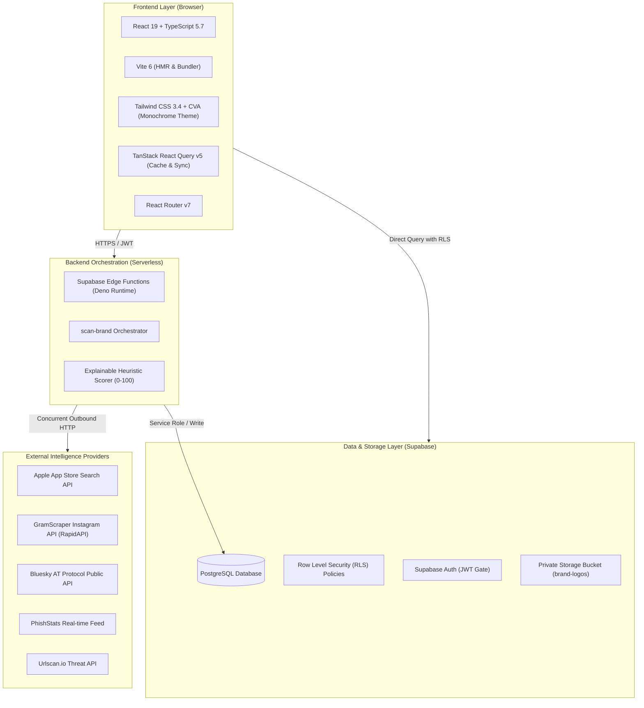

# 🛠️ Byte Guard — Tech Stack & Technical Architecture

A comprehensive breakdown of all technologies, architectural layers, external intelligence services, and development dependencies powering **Byte Guard**.

---

## 🏛️ Architecture Overview



---

## 💻 1. Frontend Layer

| Technology | Version | Purpose & Architectural Rationale |
| :--- | :---: | :--- |
| **[React](https://react.dev/)** | `19.0.0` | Core UI engine utilizing modern concurrent features, fast reconciliation, and declarative component architecture. |
| **[TypeScript](https://www.typescriptlang.org/)** | `5.7.2` | Strict compile-time type safety across candidate models, API schemas, and incident states. |
| **[Vite](https://vitejs.dev/)** | `6.0.5` | Next-generation frontend build tool providing lightning-fast Hot Module Replacement (HMR) and optimized rollup production bundles. |
| **[React Router DOM](https://reactrouter.com/)** | `7.1.1` | Declarative client-side routing for multi-view analyst workspace (`/dashboard`, `/brands`, `/monitor`, `/settings`). |
| **[@tanstack/react-query](https://tanstack.com/query)** | `5.66.8` | Asynchronous server-state management, automated background query refetching, mutation lifecycle, and cache invalidation. |
| **[Tailwind CSS](https://tailwindcss.com/)** | `3.4.17` | Utility-first styling powering a customized, high-density monochrome and dark-mode aesthetic for security operations centers. |
| **[Lucide React](https://lucide.dev/)** | `0.468.0` | Modern, consistent icon library for telemetry indicators, platform identifiers, and threat status badges. |
| **[React Hook Form](https://react-hook-form.com/)** | `7.57.0` | Performant, uncontrolled form management minimizing re-renders when managing brand assets. |
| **[Zod](https://zod.dev/)** | `3.25.76` | Runtime schema validation for brand input data and external response normalization. |
| **`class-variance-authority`** | `0.7.1` | Type-safe variant abstractions for reusable design-system buttons, badges, and cards. |
| **`clsx` & `tailwind-merge`** | `2.1.1` / `3.0.1` | Conditional styling and conflict resolution for dynamic Tailwind classes. |
| **[date-fns](https://date-fns.org/)** | `4.1.0` | Lightweight date manipulation and formatting for scan timestamps and incident chronologies. |

---

## ⚙️ 2. Backend & Serverless Layer

| Technology | Role | Details |
| :--- | :--- | :--- |
| **Supabase Edge Functions** | Serverless Backend | Powered by the **Deno** runtime; executes ultra-low-latency code geographically close to users without maintaining persistent server instances. |
| **`scan-brand` Function** | Scan Orchestration | Authenticates requests via Bearer JWT, validates organization membership, and runs concurrent sub-queries via `Promise.allSettled`. |
| **Circuit Breakers & Timeouts** | Reliability Guard | Each external provider call is strictly bounded by an **8-second timeout** and per-provider try/catch blocks to ensure that third-party outages never crash the scanner. |
| **Exact Whitelist Engine** | False Positive Mitigation | Evaluates candidate records against verified brand URLs, app bundle IDs, and social handles, automatically dropping official assets prior to the threat queue. |
| **Multi-Signal Scorer** | Risk Engine | Normalizes disparate provider data into a deterministic, explainable **0–100 heuristic risk score**. |

---

## 🗄️ 3. Database, Auth & Security

| Technology | Role | Details |
| :--- | :--- | :--- |
| **[PostgreSQL](https://www.postgresql.org/)** | Primary Database | Relational database hosted on Supabase, handling brand profiles, normalized candidates, provider logs, and analyst feedback. |
| **Row Level Security (RLS)** | Multi-Tenant Isolation | Strictly isolates organizations. Browser clients authenticate via JWT and can only read/write records matching their organization ID. |
| **Supabase Auth** | Access Control | Role-based authentication using email/password and secure session tokens stored client-side. |
| **Supabase Storage** | Private Asset Bucket | Secure bucket (`brand-logos`) restricted to PNG, JPEG, and WebP images up to 5MB, governed by granular storage policies. |
| **Secret Vault** | Secrets Management | Provider API keys (`URLSCAN_API_KEY`, `GRAMSCRAPER_API_KEY`, `SUPABASE_SERVICE_ROLE_KEY`) are stored in Supabase secrets, never exposed to client bundles. |

---

## 📡 4. External APIs & Intelligence Feeds

| Provider | Category | Endpoint / Protocol | Extracted Metadata |
| :--- | :--- | :--- | :--- |
| **Apple iTunes Search API** | Mobile App Catalog | `https://itunes.apple.com/search` | App name, seller/developer name, bundle ID, store URL, artwork URL, rating, download heuristic |
| **GramScraper API (RapidAPI)** | Social Networks (Instagram) | `https://gramscraper.p.rapidapi.com` | Profile handles, full names, bio descriptions, external website links, follower counts, verified flags |
| **Bluesky Public API** | Decentralized Social (AT Protocol) | `https://public.api.bsky.app/xrpc` | Actor display names, `.bsky.social` handles, profile bios, avatar image URLs |
| **PhishStats API** | Real-time Threat Intelligence | `https://api.phishstats.info/api/phishing` | Live phishing URLs, target hostnames, IP geography, country codes, antivirus consensus scores |
| **Urlscan.io Search API** | Web & Domain Telemetry | `https://urlscan.io/api/v1/search` | Historical URL scans, page titles, observed domain names, screenshot metadata |

---

## 🧪 5. Testing & Quality Tooling

| Tool | Version | Purpose |
| :--- | :---: | :--- |
| **[Vitest](https://vitest.dev/)** | `2.1.8` | High-performance test runner with native ESM and TypeScript support. |
| **[@testing-library/react](https://testing-library.com/)** | `16.1.0` | UI component testing focusing on user-centric behavior. |
| **`jsdom`** | `25.0.1` | DOM environment simulation for browserless unit and integration testing. |
| **[ESLint](https://eslint.org/)** | `9.17.0` | Static code analysis with modern flat config enforcing strict quality rules. |
| **`typescript-eslint`** | `8.18.2` | Advanced TypeScript-specific linting rules preventing unsafe any-types and unhandled promises. |
| **`tsx`** | `4.19.2` | Zero-config TypeScript command-line execution for seeding database fixtures (`scripts/seed-demo.ts`). |

---

## 📦 Complete Package Dependency Manifest

```json
{
  "dependencies": {
    "@hookform/resolvers": "5.2.2",
    "@supabase/supabase-js": "2.57.4",
    "@tanstack/react-query": "5.66.8",
    "class-variance-authority": "0.7.1",
    "clsx": "2.1.1",
    "date-fns": "4.1.0",
    "lucide-react": "0.468.0",
    "react": "19.0.0",
    "react-dom": "19.0.0",
    "react-hook-form": "7.57.0",
    "react-router-dom": "7.1.1",
    "tailwind-merge": "3.0.1",
    "zod": "3.25.76"
  },
  "devDependencies": {
    "@eslint/js": "9.17.0",
    "@testing-library/jest-dom": "6.6.3",
    "@testing-library/react": "16.1.0",
    "@types/node": "22.10.5",
    "@types/react": "19.0.2",
    "@types/react-dom": "19.0.2",
    "@vitejs/plugin-react": "4.3.4",
    "autoprefixer": "10.4.20",
    "eslint": "9.17.0",
    "eslint-plugin-react-hooks": "5.1.0",
    "eslint-plugin-react-refresh": "0.4.18",
    "globals": "15.14.0",
    "jsdom": "25.0.1",
    "postcss": "8.4.49",
    "tailwindcss": "3.4.17",
    "tsx": "4.19.2",
    "typescript": "5.7.2",
    "typescript-eslint": "8.18.2",
    "vite": "6.0.5",
    "vitest": "2.1.8"
  }
}
```

---

## 🛡️ Key Architectural Principles

1. **Defensive & Passive Only**:
   Byte Guard operates purely as an observation and risk detection platform. It never performs port scanning, brute-forcing, intrusive web scraping, or unconfirmed automated takedown requests.
2. **Zero False Positives via Asset Precedence**:
   Official assets defined by the brand are mathematically prioritized and whitelisted before scoring occurs.
3. **Resilient Degradation**:
   Third-party API rate limits or failures are captured cleanly and presented on the UI as provider telemetry, preventing systemic scan failures.
