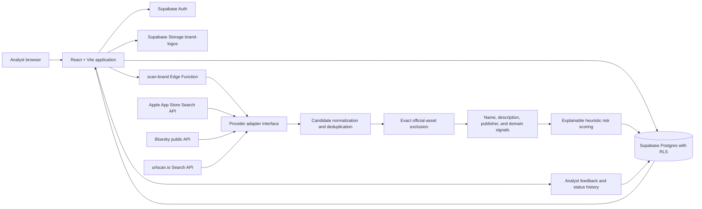

# Architecture

ByteXL keeps organization-scoped records in Supabase. The browser uses a publishable key and Row Level Security; provider credentials and scan orchestration live only in the authenticated Edge Function.

## Data flow

1. An authenticated analyst creates a protected brand and registers authoritative IDs, URLs, domains, publishers, and optional logo.
2. A live scan invokes `scan-brand`. It verifies the caller belongs to the brand’s organization, blocks a concurrent scan, and starts provider adapters independently.
3. Every provider attempt becomes a `scan_sources` record. Apple and Bluesky do not need keys; urlscan.io is marked unavailable when its Edge Function secret is absent. No fake candidates are created.
4. Returned source fields are normalized and upserted using the organization, source type, platform, and provider external ID.
5. A verified exact account ID, application identifier, listing ID, or URL excludes that candidate before the active threat queue.
6. Non-excluded candidates receive individually recorded name, description, publisher, and domain signals. Logo similarity remains unavailable until a safe compatible server-side image adapter is configured.
7. The score is a 0–100 heuristic normalized over available weights. It is not a probability or an automated threat decision.
8. Analysts review status and notes; feedback is retained as a separate audit trail.

## Security boundaries

- Browser clients use only `VITE_SUPABASE_URL` and a publishable key.
- Tables use organization-scoped Row Level Security; the browser cannot read or modify records outside its memberships.
- Edge Function secrets remain in Supabase secret storage. The function validates the caller and organization membership before service-role persistence.
- Brand-logo uploads are private, limited to PNG/JPEG/WebP and 5 MB by Storage configuration and path policy.
- The implementation does not fetch arbitrary user-provided URLs. The two implemented providers use fixed HTTPS endpoints. Image similarity does not download external images until a safe adapter with SSRF controls is introduced.
